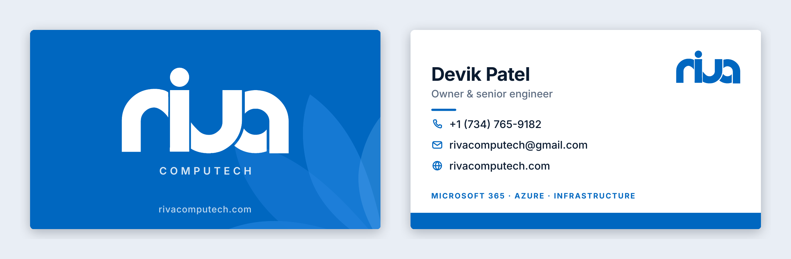

# Riva Computech business card



| File | What it's for |
| --- | --- |
| `riva-business-card.pdf` | **Send this to the printer.** Page 1 = front, page 2 = back. |
| `riva-business-card-front.svg` · `-back.svg` | **Editable.** Open in Inkscape, Illustrator, Figma or Canva and change the text. |
| `riva-business-card-preview.png` | Picture of both sides, trimmed, for sharing. |

**Print specs:** US standard 3.5 × 2 in, with 1/8 in bleed on every side (each page is 3.75 × 2.25 in).
The PDF marks the trim line (TrimBox), so printers cut in the right place. Text is real, selectable
text with Inter embedded, and everything is vector. Colours are RGB (brand blue `#0067c0`), which online
printers convert for you. Order a proof first, because blues print a touch darker.

**Editing:** the text is live and set in **Inter** (free from fonts.google.com). Install it first, or
your editor will swap in another font. Keep text inside the safe area: turn on the hidden
"Guides" layer to see the trim (pink) and safe area (dashed blue). Background colour and the petals
run to the canvas edge on purpose: that's the bleed.

**Rebuilding** (only needed after editing `build.py`):

```bash
pip install fonttools
python3 print/business-card/build.py path/to/inter-latin-600-normal.woff
INTER_DIR=path/to/inter-files node print/business-card/make-pdf.cjs   # needs Playwright
python3 print/business-card/set-boxes.py                              # needs pypdf
python3 print/business-card/make-preview.py                           # needs Pillow + pdftoppm
```

To change the details on the card (name, phone, email), edit the `rows` and text lines in `build.py` and
run the four commands above, so the SVGs, PDF and preview all stay in step.

`build.py` also writes the full logo lockups, `public/brand/riva-computech-logo.svg` and
`riva-computech-logo-white.svg` (wordmark + COMPUTECH as outlines, so they need no font).
